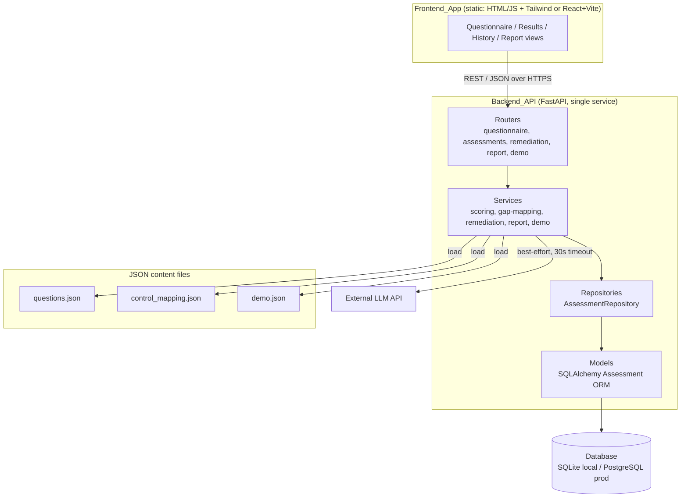
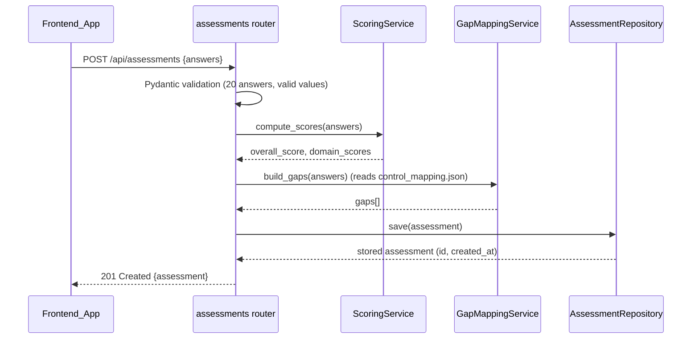

# Design Document

## Overview

ComplyPK is a cyber-security **readiness assessment** tool for Pakistani SMEs and fintechs. It is intentionally scoped for a 2-day solo build: a single FastAPI service plus a simple static frontend, both deployed to managed hosts. There are no queues, caches, background workers, or authentication.

The backend loads a fixed 20-question questionnaire and an editable control mapping from JSON files, scores submitted answers overall and per domain, classifies failed items as gaps mapped to ISO 27001 / NIST CSF controls with a severity, generates a remediation plan (LLM with template fallback), persists each assessment, and exports a report (Markdown required, PDF optional). A demo mode supplies a sample fintech's prefilled answers.

The code is cleanly layered (`routers → services → repositories → models`), uses Pydantic for all request/response schemas, and reads all configuration from environment variables. Every user-facing result and report carries a fixed disclaimer stating this is a readiness assessment only — not certification or guaranteed compliance.

Design decisions map back to requirements throughout, cited as (Req X.Y).

### Key Design Decisions

- **Single table with JSON columns** (Req 2.4, 4.2): There is exactly one entity to persist — the completed assessment. Answers, domain scores, and gaps are heterogeneous nested data read as a unit, so storing them as JSON columns on one `assessments` table avoids join complexity and matches the 2-day scope. The remediation plan is derived on demand and may also be cached in the same row.
- **JSON-file-driven questionnaire & mapping** (Req 1.1, 3.4): Keeping questions and control mappings in editable JSON files (not the DB, not hard-coded) satisfies the "editable, not hard-coded" constraint and keeps content changes code-free.
- **Fallback-first remediation** (Req 5.4, 5.5): The LLM is best-effort. Any failure, timeout, or missing key degrades gracefully to a deterministic template generator, always returning HTTP 200 with a source indicator.
- **Config fails fast** (Req 9.4, 9.5): Missing allowed-origin or malformed `DATABASE_URL` aborts startup rather than serving a misconfigured service.

## Architecture

### Module Diagram



### Layering Rules (Req 12.2)

- **Routers** depend only on services. They parse/validate requests via Pydantic schemas and shape HTTP responses and status codes.
- **Services** hold all business logic (scoring, gap classification, remediation, report rendering, demo sourcing) and depend only on repositories and the JSON content loaders.
- **Repositories** depend only on models and encapsulate all DB access (SQLAlchemy session usage).
- **Models** are SQLAlchemy ORM entities and have no upward dependencies.

No reverse dependencies are permitted. All request/response structures are Pydantic schemas (Req 12.3). Source is split into `/backend` and `/frontend` folders (Req 12.1).

### Request Flow Example (Submit Assessment)



## Components and Interfaces

### Routers (`/backend/app/routers`)

| Router | Responsibility |
| --- | --- |
| `questionnaire` | Serve the questionnaire grouped by domain (Req 1) |
| `assessments` | Submit assessment, list history, get single (Req 2, 4) |
| `remediation` | Generate/retrieve remediation plan (Req 5) |
| `report` | Export report in markdown/pdf (Req 6) |
| `demo` | Serve demo-mode sample data (Req 7) |

### Services (`/backend/app/services`)

- **ContentLoader** — loads and validates `questions.json`, `control_mapping.json`, `demo.json`; raises a typed error that routers translate to HTTP 500 without stack traces (Req 1.4, 1.5, 3.6, 7.5).
- **ScoringService** — computes overall and per-domain scores from answer weights yes=1.0, partial=0.5, no=0.0 (Req 2.1–2.3).
- **GapMappingService** — classifies "no"/"partial" answers as gaps, attaches ISO/NIST references from the control mapping, assigns severity no→high, partial→medium (Req 3.1–3.5).
- **RemediationService** — calls the external LLM (30s cap), orders steps by severity then ascending question id, ensures ≥1 step per gap; delegates to **FallbackGenerator** on missing key/failure/timeout and records the source (Req 5.1–5.6).
- **ReportService** — renders Markdown (always) and PDF (optional) including all required sections and the disclaimer; refuses to produce a report without the disclaimer (Req 6.3–6.5, 8.3, 8.4).
- **DemoService** — returns a fixed sample fintech profile plus one valid answer per question (Req 7.1, 7.4).

### Repository (`/backend/app/repositories`)

`AssessmentRepository` methods:
- `save(assessment) -> Assessment`
- `list() -> list[Assessment]` ordered by `created_at DESC, id DESC` (Req 4.1)
- `get(assessment_id) -> Assessment | None` (Req 4.2, 4.3)
- `update_remediation(assessment_id, plan) -> Assessment` (cache generated plan)

### Cross-Cutting

- **Error handling middleware** returns a consistent JSON error body `{ "message": string, "error_ref": uuid }`, maps unhandled errors to HTTP 500 with a generic message, and never leaks stack traces, paths, or secrets (Req 11.1, 11.2, 9.8).
- **CORS middleware** permits only the configured allowed frontend origin; non-matching origins get no CORS headers so the browser blocks them (Req 12.4, 12.5).
- **Body size limit** rejects oversized bodies with HTTP 413 (Req 10.6).
- **Config module** reads env vars at startup and fails fast on missing allowed-origin or malformed `DATABASE_URL` (Req 9.1–9.5).

## Data Models

### Database Schema — single `assessments` table (Req 2.4, 4.2)

Exactly one table. All nested, heterogeneous data is stored in JSON columns. `JSON` maps to SQLite `TEXT`(JSON) and PostgreSQL `JSONB` via SQLAlchemy's `JSON` type.

| Column | Type | Notes |
| --- | --- | --- |
| `id` | INTEGER (SQLite) / BIGSERIAL (PG), PK, autoincrement | Unique assessment identifier (Req 2.5, 4.2) |
| `answers` | JSON | `{ "<question_id>": "yes"\|"partial"\|"no", ... }` — all 20 answers (Req 2.4) |
| `overall_score` | INTEGER | 0–100 (Req 2.1) |
| `domain_scores` | JSON | `{ "Access Control": 80, "Backup & Recovery": 50, ... }` (Req 2.2) |
| `gaps` | JSON | list of gap objects (see below) (Req 3) |
| `remediation_plan` | JSON, nullable | cached plan `{ "source": "llm"\|"fallback", "steps": [...] }`; null until generated (Req 5, 6.4) |
| `created_at` | DATETIME / TIMESTAMPTZ, not null, default now | creation timestamp (Req 2.4, 4.1) |

Index: `created_at DESC` to support history ordering (Req 4.1).

**Gap object shape (inside `gaps` JSON):**
```json
{
  "question_id": "AC-1",
  "domain": "Access Control",
  "answer": "no",
  "severity": "high",
  "iso_27001": ["A.5.15"],
  "nist_csf": ["PR.AC-1"]
}
```

### Pydantic Schemas (Req 12.3, 10.1)

- `AnswerSubmission` — `{ answers: dict[str, Literal["yes","partial","no"]] }`; validates all 20 question ids present and values in the allowed set (Req 2.6, 10.4).
- `QuestionnaireResponse` — domains → list of `Question { id, text, domain, allowed_answers }` (Req 1.3).
- `AssessmentResponse` — `{ id, created_at, overall_score, domain_scores, gaps, disclaimer }` (Req 4.2, 8.2).
- `AssessmentSummary` — `{ id, created_at, overall_score }` for history (Req 4.5).
- `RemediationPlanResponse` — `{ source, steps: [{ question_id, severity, action }], disclaimer }` (Req 5.2, 5.6).
- `ErrorResponse` — `{ message, error_ref }` (Req 11.2).

### JSON Content File Formats

**`questions.json`** — exactly 20 questions across the six domains (Req 1.1–1.3, 1.5):
```json
{
  "questions": [
    {
      "id": "AC-1",
      "domain": "Access Control",
      "text": "Do you enforce unique user accounts with strong passwords and MFA for critical systems?",
      "allowed_answers": ["yes", "partial", "no"]
    },
    {
      "id": "BR-1",
      "domain": "Backup & Recovery",
      "text": "Do you take regular backups and test restoration periodically?",
      "allowed_answers": ["yes", "partial", "no"]
    }
  ]
}
```

**`control_mapping.json`** — editable per-question ISO/NIST references; a missing question or standard yields an empty list (Req 3.2, 3.4, 3.5):
```json
{
  "AC-1": {
    "iso_27001": ["A.5.15", "A.5.16"],
    "nist_csf": ["PR.AC-1", "PR.AC-4"]
  },
  "BR-1": {
    "iso_27001": ["A.8.13"],
    "nist_csf": ["PR.IP-4"]
  }
}
```

**`demo.json`** — fixed sample fintech profile and one valid answer per question (Req 7.1, 7.4):
```json
{
  "company": {
    "name": "Karachi FinServ (Pvt) Ltd",
    "sector": "Fintech",
    "size": "45 employees"
  },
  "answers": {
    "AC-1": "partial",
    "BR-1": "yes",
    "PT-1": "no"
  }
}
```

## Correctness Properties

*A property is a characteristic or behavior that should hold true across all valid executions of a system — essentially, a formal statement about what the system should do. Properties serve as the bridge between human-readable specifications and machine-verifiable correctness guarantees.*

The scoring, gap-classification, severity, remediation-ordering, and report-rendering logic are pure functions over structured input, so property-based testing applies well. Infrastructure, config, CORS, and UI criteria are covered by example/integration/smoke tests in the Testing Strategy instead. The properties below were consolidated during prework reflection to remove redundancy.

### Property 1: Overall score formula and bounds

*For any* valid set of 20 answers, the computed Overall_Score equals `round(sum(weight) / 20 * 100)` using weights yes=1.0, partial=0.5, no=0.0, and lies within [0, 100]; all-"yes" yields 100 and all-"no" yields 0.

**Validates: Requirements 2.1, 2.3**

### Property 2: Domain score formula and bounds

*For any* valid set of 20 answers, each of the six Domain_Scores equals `round(sum(domain weights) / domain question count * 100)` and lies within [0, 100].

**Validates: Requirements 2.2, 2.3**

### Property 3: Assessment persistence round-trip

*For any* valid submission, saving the Assessment and then retrieving it by its returned identifier yields the same answers, Overall_Score, Domain_Scores, and Gaps, with a non-null identifier and creation timestamp.

**Validates: Requirements 2.4, 2.5, 4.2**

### Property 4: Invalid submission is rejected without persistence

*For any* submission that omits at least one of the 20 Questions, contains an Answer_Value outside {"yes","partial","no"}, or references an unknown Question identifier, the Backend_API responds with HTTP 422 and the stored Assessment count is unchanged.

**Validates: Requirements 2.6, 10.2, 10.4**

### Property 5: Gap classification matches non-passing answers

*For any* valid set of answers, the set of Gaps equals exactly the Questions answered "no" or "partial", and no Question answered "yes" appears as a Gap.

**Validates: Requirements 3.1**

### Property 6: Gap control references match the mapping

*For any* valid set of answers and any Control_Mapping, each Gap's ISO_27001 and NIST_CSF lists equal the references defined for that Question in the mapping, or the empty list when the Question (or that standard) has no entry.

**Validates: Requirements 3.2, 3.5**

### Property 7: Gap severity rule

*For any* valid set of answers, every Gap from a "no" answer has Severity "high" and every Gap from a "partial" answer has Severity "medium".

**Validates: Requirements 3.3**

### Property 8: History ordering

*For any* set of stored Assessments, the history list is ordered by creation timestamp descending, with ties broken by identifier descending.

**Validates: Requirements 4.1**

### Property 9: Remediation step ordering

*For any* Assessment's Gaps, the returned Remediation_Plan orders steps so that higher-Severity steps precede lower-Severity steps, and steps of equal Severity are ordered by ascending Question identifier.

**Validates: Requirements 5.2**

### Property 10: Remediation covers every gap (including fallback)

*For any* Assessment's Gaps, the generated Remediation_Plan includes at least one step addressing each Gap's Question identifier; this holds for the Fallback_Generator output when the LLM_API_KEY is unset.

**Validates: Requirements 5.3, 5.4**

### Property 11: Report content completeness

*For any* Assessment, the produced Report contains the Overall_Score, a Domain_Score for each of the six Domains, every Gap with its Severity and its ISO_27001 and NIST_CSF references, and the Remediation_Plan section.

**Validates: Requirements 6.3**

### Property 12: Report always contains the disclaimer

*For any* Assessment, the produced Report contains the Disclaimer text; a Report is never produced without it.

**Validates: Requirements 6.5, 8.3**

### Property 13: Readiness-only wording

*For any* user-facing Assessment result or Report, the output contains the phrase "readiness assessment" and does not contain the terms "certification", "certified", "guaranteed compliance", or "compliant".

**Validates: Requirements 8.1**

### Property 14: Consistent error structure

*For any* request that triggers an error response, the response body is a JSON object containing a human-readable `message` and a unique `error_ref`, and exposes no stack trace, file path, or secret value.

**Validates: Requirements 11.2, 11.1, 9.8**

## Error Handling

| Condition | Status | Behavior | Requirement |
| --- | --- | --- | --- |
| Questionnaire file missing/unparseable/invalid | 500 | Generic "questionnaire could not be loaded / invalid"; no stack trace; no partial data | 1.4, 1.5 |
| Submission missing questions / invalid value / unknown id | 422 | Identify offending question ids and values; persist nothing | 2.6, 10.2, 10.4 |
| Control mapping file missing/unparseable | 500 | Descriptive, no stack trace; no partial persist | 3.6 |
| Unknown assessment id (get / remediation / report) | 404 | Descriptive message; no data | 4.3, 5.7, 6.6 |
| Invalid id type/format | 422 | Descriptive, consistent structure | 4.6, 10.3 |
| LLM failure or 30s timeout / no key | 200 | Fall back to template plan, mark `source=fallback` | 5.4, 5.5 |
| Invalid report format | 422 | Identify invalid format; no report | 6.7 |
| Disclaimer cannot be included | error | Do not produce report | 8.4 |
| Demo data missing/invalid | 500 | Descriptive; no partial data | 7.5 |
| Malformed/empty JSON body | 422 | Descriptive, consistent structure | 10.5 |
| Body exceeds max size | 413 | Reject before processing | 10.6 |
| Unhandled exception | 500 | Generic message; no stack/path/secret leak | 11.1, 9.8 |
| DB unreachable within 5s | 503 | `Retry-After` ≤ 30s | 11.3 |
| Missing allowed origin / malformed DATABASE_URL | startup abort | Fail fast; never echo DATABASE_URL value | 9.4, 9.5 |

All error responses share the JSON shape `{ "message": string, "error_ref": uuid }` (Req 11.2). A FastAPI exception handler centralizes this, generating an `error_ref` (UUID) per error for log correlation while keeping the client message generic.

## Testing Strategy

### Framework

- Backend: **pytest** with **Hypothesis** for property-based tests (do not hand-roll PBT). FastAPI `TestClient` for API-level tests; an in-memory/temp SQLite DB per test.
- Each property test runs **minimum 100 iterations** and is tagged with a comment:
  `# Feature: complypk, Property {number}: {property_text}`

### Property-Based Tests (Hypothesis)

Implement the 14 correctness properties above, one property-based test each, with generators for:
- Arbitrary valid answer maps over the 20 question ids (drives P1, P2, P3, P5, P6, P7).
- Invalid submissions: drop ids, inject illegal values, inject unknown ids (P4).
- Arbitrary control mappings including unmapped questions (P6).
- Arbitrary sets of persisted assessments with varied timestamps/ids (P8).
- Arbitrary gap sets of mixed severity (P9, P10).
- Arbitrary assessments for report rendering (P11, P12, P13).
- Arbitrary error-triggering requests (P14).

### Example / Edge-Case Unit Tests

- Questionnaire load returns 20 questions, six domains, required fields (Req 1.1–1.3); missing/invalid file → 500 (1.4, 1.5).
- Empty history → 200 `[]` (4.4); history item fields (4.5); unknown/invalid id → 404/422 (4.3, 4.6).
- Report default markdown (6.2), optional pdf (6.1), no-plan placeholder (6.4), invalid format → 422 (6.7), unknown id → 404 (6.6).
- Demo returns valid answer per question (7.1, 7.4); corrupt demo → 500 (7.5).
- Malformed JSON → 422 (10.5); oversized body → 413 (10.6).

### Integration / Smoke Tests

- LLM wiring and timeout with a mocked client (5.1); fallback on raise/timeout returns 200 (5.5).
- DB-down → 503 with `Retry-After` (11.3).
- Config: unset DATABASE_URL → SQLite (9.2); PostgreSQL URL → PG (9.3); missing origin / malformed URL → startup abort without leaking the URL (9.4, 9.5).
- CORS: allowed origin permitted (12.4); other origin gets no CORS headers (12.5).
- Smoke: `/backend` & `/frontend` exist (12.1), `.env.example` present (9.6), `.gitignore` excludes `.env` (9.7), pytest suite green (12.6), deploy artifacts present (12.7).

Required coverage per Req 12.6: scoring (P1, P2), gap mapping (P5, P6, P7), and Fallback_Generator (P10 + fallback edge tests).

## Deployment Notes

### Topology

- **Backend host**: a single container/service on a managed platform (e.g. Render, Railway, Fly.io, or any Docker host). Served by `uvicorn`. A `Dockerfile` is provided (satisfies Req 12.7); alternatively documented `pip install -r requirements.txt && uvicorn app.main:app` steps.
- **Frontend host**: static hosting (e.g. Netlify, Vercel, GitHub Pages, or Cloudflare Pages). The frontend is a static bundle (plain HTML/JS + Tailwind, or React+Vite `npm run build`) that calls the backend base URL via an injected `API_BASE_URL`.
- **Database**: SQLite file locally; a managed PostgreSQL instance in production selected via `DATABASE_URL` (Req 9.2, 9.3).

### CORS (Req 12.4, 12.5)

FastAPI `CORSMiddleware` is configured with `allow_origins=[ALLOWED_FRONTEND_ORIGIN]` (exact match, read from env). Requests from the configured origin receive CORS headers; all other origins receive none, so the browser blocks the response. The service refuses to start if the allowed origin is unset (Req 9.4).

### Environment Variables (Req 9.1, documented in `.env.example`)

| Variable | Required | Purpose | Default |
| --- | --- | --- | --- |
| `ALLOWED_FRONTEND_ORIGIN` | Yes | Exact origin permitted by CORS; startup aborts if missing (9.4) | — |
| `DATABASE_URL` | No | DB connection string; PostgreSQL in prod | local SQLite (9.2) |
| `LLM_API_KEY` | No | Credential for the external LLM; absent → fallback generator (5.4) | — |

Secrets are never committed: `.env` is git-ignored (Req 9.7) and `.env.example` documents the variables with placeholder values only (Req 9.6). Secret values never appear in responses, logs, or error messages (Req 9.8), and a malformed `DATABASE_URL` aborts startup without echoing its value (Req 9.5).

### Report Export Scope

Markdown export is **required** and is the default format (Req 6.1, 6.2). PDF export is **optional**; if the PDF path is not implemented, requesting `format=pdf` may return a clear "not available" response while markdown remains fully supported. All exported reports include the Disclaimer and readiness-only wording (Req 6.5, 8.1, 8.3).

### Disclaimer (fixed text, Req 8.2–8.4)

> **Disclaimer:** ComplyPK provides a readiness assessment only. It does not constitute certification or a guarantee of compliance with any standard or regulation.

This text appears on the frontend results view without extra interaction (Req 8.2) and in every exported report (Req 8.3). A report is never produced if the disclaimer cannot be included (Req 8.4).
